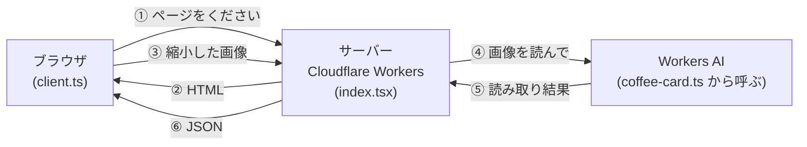

# アーキテクチャ

このアプリがどう動いているかを、全体像 → データの流れ → 各ファイル → 設計の理由 の順に説明します。

## 1. 全体像

登場人物は3つだけです。



- **ブラウザ**：画面の表示、写真の選択、画像の縮小、結果をフォームに入れる。
- **サーバー（Cloudflare Workers）**：HTML を返す。画像を受け取ってチェックし、AI に渡す。
  - Workers は Cloudflare が世界中で動かしてくれるサーバーです。自分でサーバーを用意する必要がありません。
- **Workers AI**：Cloudflare が提供する AI。サーバーのコードから `c.env.AI.run(...)` で呼べます。

サーバー側のフレームワークは **Hono**（ホノ）です。「この URL に来たらこの処理」というルールを短く書けます。

## 2. データの流れ（写真を選んでからフォームが埋まるまで）

```
[1] ユーザーが写真を選ぶ                      client.ts  input の "change" イベント
     ↓
[2] 画像を開く（HEIC なら変換）                client.ts  decode()
     ↓
[3] 長い辺を 1280px に縮小して JPEG に         client.ts  resize()
     ↓  FormData に入れて POST /api/extract
[4] 画像のチェック（有無・形式・4MB 以下）      index.tsx  app.post("/api/extract")
     ↓
[5] AI その1：カードを読んで「見出し: 値」の行に書き出す   coffee-card.ts  transcribe()
     ↓  例) "Country: Nicaragua\nFarm: Finca El Porvenir\n..."
[6] AI その2：その文章から各項目を取り出す + 自信度         coffee-card.ts  extractCoffeeCard()
     ↓
[7] 後処理：大文字を整える、品種などをリストに分割           coffee-card.ts  text() / list() / normalizeCase()
     ↓  JSON で返す
[8] フォームに値を入れ、自信度 0.6 未満はオレンジ表示       client.ts  fill()
```

### エラーのとき

| どこで | 何が起きる | 画面の表示 |
|---|---|---|
| [2] ブラウザで開けない画像 | `Error` を投げる | 「この画像は読み込めません…」 |
| [4] チェックに引っかかる | HTTP 400 + `{ error }` | 該当のメッセージ |
| [5][6] AI が失敗 | HTTP 502 + `{ error }`、サーバーのログに `clairic extraction failed` | 「読み取りに失敗しました…」 |

どの場合も `client.ts` の `try / catch` が受け止めて `#status` にメッセージを出し、`finally` で入力欄を元に戻します（もう一度選べるようにする）。

## 3. 各ファイルの役割

### `src/index.tsx` — サーバーの入口

- `new Hono<{ Bindings: Env }>()` でアプリを作ります。`Env` には `wrangler.jsonc` で宣言した `AI` が入っていて、`c.env.AI` で使えます。
- `GET /`：ページを返します。フォームの項目は配列 `FIELDS` から `map` で作っているので、項目を増やすときは配列に1行足すだけです。
- 先頭の `app.use("*", ...)`：すべての URL に Basic 認証をかけます（AI の呼び出しに無料枠・料金がかかるため）。
- `POST /api/extract`：画像を受け取って `extractCoffeeCard()` に渡します。詳しくは [API.md](API.md)。
- `app.route("/", docs)`：`/docs/` 以下のドキュメントページ（`src/docs.tsx`）をつなげます。

### `src/docs.tsx` / `src/docs-client.ts` — ドキュメントページ

- `import.meta.glob("../docs/*.md", { query: "?raw" })`：Vite の機能で、ビルド時に `docs/*.md` を文字列として取り込みます。
- `marked`：Markdown を HTML に変換するライブラリ。サーバー側で変換して返します。
- `docs-client.ts`：ブラウザ側で ```` ```mermaid ```` のコードブロックを図に描き直します。`mermaid` は大きいので、図があるページでだけ動的 import します。

`.tsx` なのは、HTML を **JSX**（JavaScript の中に HTML っぽく書く記法）で書いているからです。React ではなく Hono 付属の JSX（`hono/jsx`）を使っています（`tsconfig.json` の `jsxImportSource`）。

### `src/renderer.tsx` — HTML の共通の枠

`<html>` `<head>` `<body>` を毎回書かなくて済むように、`app.use(renderer)` で全ページに共通の枠をかぶせています。`c.render(...)` に渡した中身が `{children}` に入ります。

`<Script src="/src/client.ts" />` と `<Link href="/src/style.css" />` は `vite-ssr-components` の部品で、開発中は元のファイルを、本番ではビルド後のファイル名を自動で指してくれます。

### `src/client.ts` — ブラウザで動くコード

サーバーではなく**ユーザーのブラウザ**で動きます。ここだけ `document` や `canvas` が使えるのはそのためです（先頭の `/// <reference lib="dom" />` で TypeScript に伝えています）。

- `decode()`：まず `createImageBitmap` で開いてみて、失敗したら HEIC（iPhone の写真形式）とみなして `heic-to` で変換します。`heic-to` は約 3MB と大きいので、必要なときだけ `await import()` で読み込みます（**動的 import**）。
- `resize()`：`<canvas>` に縮小して描き、JPEG（画質 0.85）に変換します。
- `fill()`：返ってきた JSON をフォームに入れます。配列は `", "` でつなげて表示します。

### `src/coffee-card.ts` — AI でカードを読む（心臓部）

AI を**2段階**で使っているのがポイントです。

1. **読み取り担当**（`OCR_MODEL` = Mistral Small 3.1）：画像を見て、決まった見出し（`Country:` `Farm:` …）の行に書き直させます。プロンプトが `OCR_PROMPT` です。
2. **抽出担当**（`EXTRACT_MODEL` = Clairic）：1 の文章（`state`）と、取り出したい項目の説明（`FIELDS`）を渡すと、項目ごとの値と自信度（`confidence`）を返します。

その後、自前の関数で仕上げます。

- `text()`：前後の空白を取り、空なら `null`。
- `list()`：品種・フレーバーを区切り文字（`,` `、` `/` など、正規表現で指定）で分けて配列にします。
- `normalizeCase()`：`NUEVA SEGOVIA` → `Nueva Segovia`。小文字が混ざる表記・日本語・数字入り（`SL-09`）はそのまま。
- `toBase64()`：画像のバイト列を AI に渡せる文字列（Base64）に変換。大きな画像で一度に変換するとエラーになるので、少しずつ処理しています。

### 設定ファイル

| ファイル | 役割 |
|---|---|
| `wrangler.jsonc` | Workers の名前、入口ファイル（`main`）、`"ai": { "binding": "AI" }` で AI を使う宣言 |
| `vite.config.ts` | `cloudflare()` で Workers を Vite 上で動かし、`ssrPlugin()` で `<Script>` などを有効にする |
| `worker-configuration.d.ts` | `wrangler types` で自動生成された型（`Env` や AI モデルの入出力型）。手で編集しない |

## 4. 設計の理由（なぜこうなっているか）

コード中のコメントに書かれている判断をまとめました。

| 判断 | 理由 |
|---|---|
| ブラウザで画像を縮小してから送る | スマホ写真は 4MB を超えやすい。フル解像度だと AI がタイムアウトした |
| AI を2段階にする | Clairic に画像を直接渡すと文字が崩れた（`NICAR` など）。2段目の回答は渡した文章の一部なので、表記が崩れない |
| 見出しの割り当ては1段目にやらせる | カードは見出しのない値が多く、ただの文字起こしだと2段目が項目を取り違えた |
| 読み取りに Mistral Small を使う | Llama 4 Scout は 70〜140 秒かかって失敗しがちだった。Mistral は 2〜5 秒 |
| 複数値の項目もテキストで受けて自分で分割 | Clairic のリスト型だと断片（`CO` `H`）が混ざった |
| 標高は数値でなくテキスト | `1,800-2,000m` のような幅のある表記が多い |
| 見出しの行がなければ `null` | 別の行から推測すると、Region に農園名が入るなどの誤りが出た |
| 自信度 0.6 未満を目立たせる | 全部を確認させるのではなく、怪しいところだけ直してもらうため |

## 5. 機能を足すときの入口

- **フォームの項目を増やす**：`coffee-card.ts` の `OCR_PROMPT`（見出し）・`FIELDS`・`CoffeeCard` 型・`extractCoffeeCard()` の戻り値と、`index.tsx` の `FIELDS` の5か所をそろえて変更します。
- **保存機能を作る**：今はフォームに入れるだけです。保存するなら Cloudflare D1（データベース）や KV を `wrangler.jsonc` に追加し、`index.tsx` に `POST /api/coffees` のような API を足すのが自然な流れです。

_最終更新: 2026-10-25_
